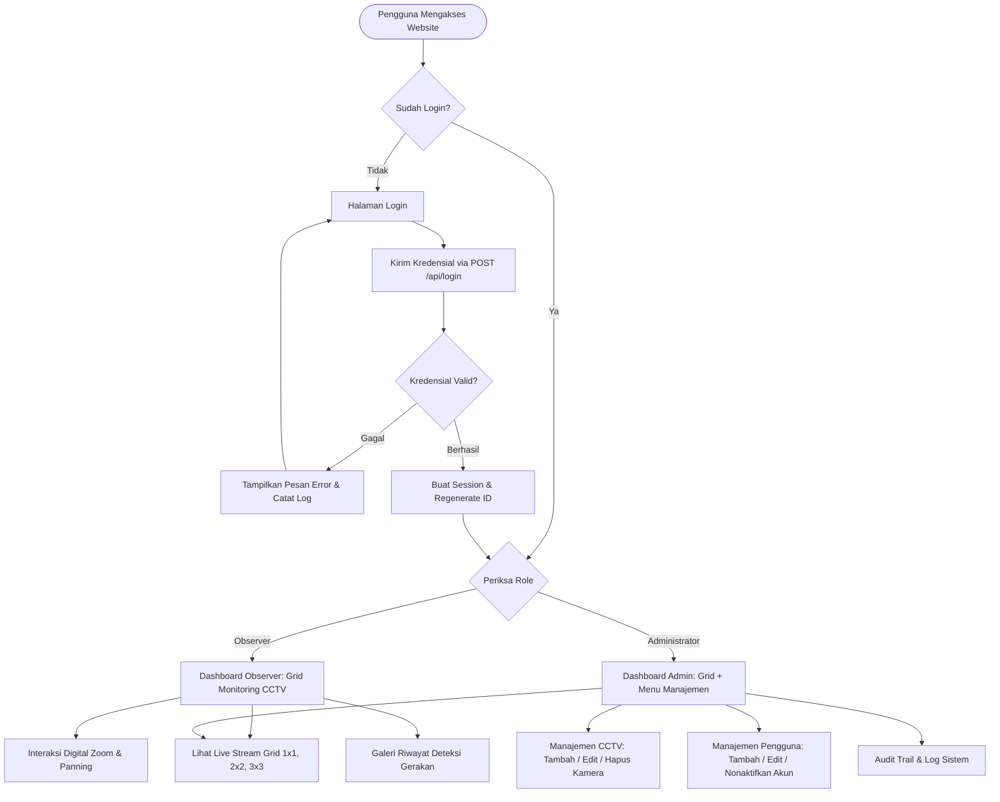
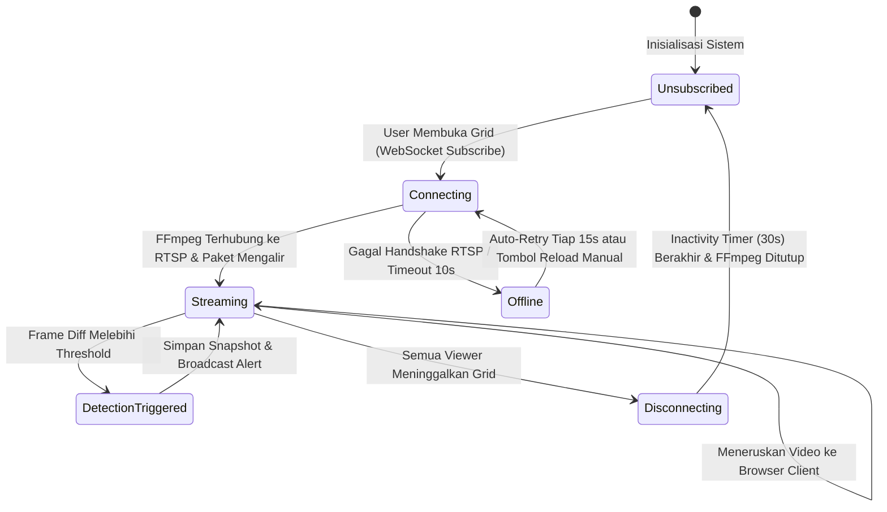
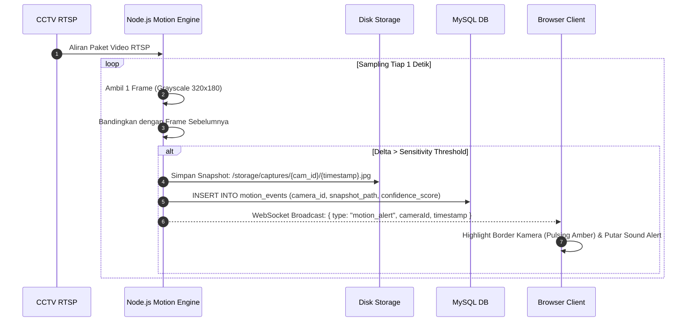

# Architecture & Flow Diagram (AFD)

Dokumen ini mendeskripsikan diagram alur data, siklus hidup koneksi kamera (*camera lifecycle*), dan alur interaksi pengguna di dalam aplikasi **RTSP Web CCTV Monitoring System**.

---

## 1. User Journey & Navigation Flow

---

## 2. Camera Stream Lifecycle Flow

---

## 3. Motion Detection & Alert Sequence

