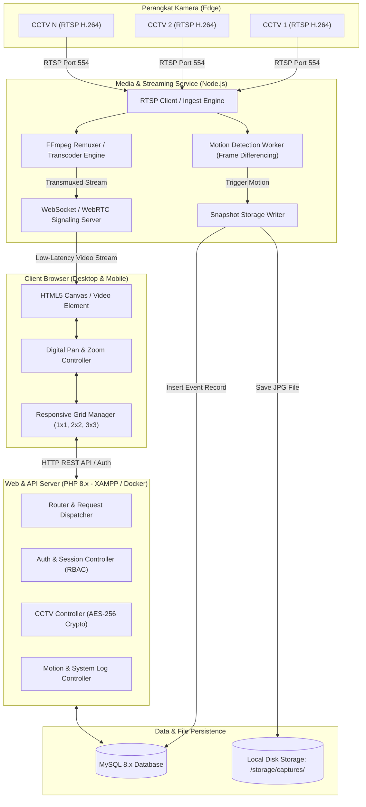
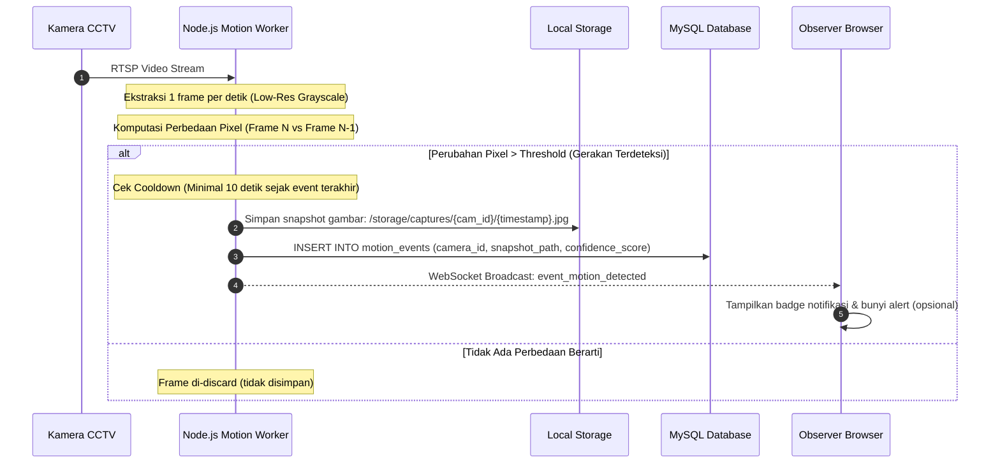
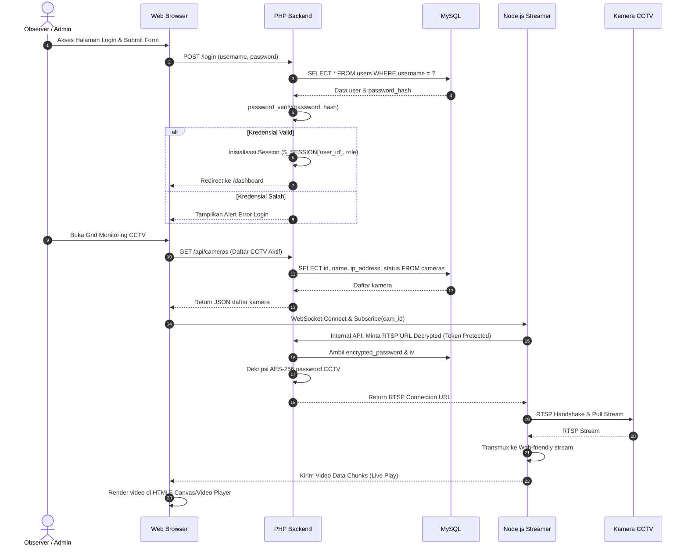

# System Architecture & Technical Design

## 1. High-Level Architecture

Sistem ini memisahkan tugas I/O intensif (transcoding video streaming dan komputasi gambar frame-diff) dari tugas aplikasi web standar (autentikasi, CRUD database, dan antarmuka pengguna).

---

## 2. Video Streaming Pipeline (RTSP to Web)

### 2.1. Mengapa Browser Tidak Mendukung RTSP?
Browser modern (Chrome, Safari, Firefox, Edge) hanya mendukung pemutaran video HTML5 dengan protokol transport **HTTP/HTTPS** atau **WebSocket / WebRTC**, dan format container seperti **MP4 (fMP4), WebM, HLS (`.m3u8`), atau raw WebRTC RTP**. 

Protokol RTSP berjalan di atas transport TCP/UDP raw dengan protokol kontrol khusus (DESCRIBE, SETUP, PLAY) yang tidak memiliki API browser native.

### 2.2. Pipeline Konversi Terpilih
Sistem mengadopsi pendekatan **Transmuxing (Bukan Re-encoding Penuh)** bilamana memungkinkan:
1. Jika kamera CCTV sudah memancarkan video codec **H.264 (AVC)**:
   - FFmpeg hanya melakukan *remuxing container* (`-c:v copy`), mengubah paket RTSP RTP langsung menjadi fMP4 atau raw WebRTC packet.
   - **Beban CPU sangat rendah ($< 3\%$ per stream)** karena tidak melakukan decode/encode ulang video bit-by-bit.
2. Jika kamera memancarkan codec lain (misal H.265 / HEVC yang tidak kompatibel di semua browser):
   - FFmpeg melakukan transcoding ringan ke H.264 baseline profile.

### 2.3. On-Demand Stream Management
Untuk menghemat pemakaian memori dan bandwidth:
- Stream FFmpeg **tidak aktif permanen** untuk semua CCTV.
- Ketika Observer membuka halaman CCTV, client mengirim sinyal `subscribe(camera_id)` via WebSocket.
- Node.js memeriksa apakah proses FFmpeg untuk kamera tersebut sudah berjalan. Jika belum, Node.js menyalakan *worker process* FFmpeg.
- Ketika semua viewer keluar dari halaman (viewer count = 0), timer 30 detik dimulai. Jika tidak ada viewer baru yang masuk, proses FFmpeg dimatikan (*graceful stop*).

---

## 3. Motion Detection Processing Pipeline

---

## 4. Sequence Diagram: Autentikasi & Live Streaming

---

## 5. Deployment Topology Comparison

### 5.1. Lingkungan Pengembangan Lokal (XAMPP + Node.js)
* **Apache & PHP 8.x:** Berjalan di `http://localhost/rstp` (Port 80 / 443).
* **MySQL Database:** Berjalan di `localhost:3306`.
* **Node.js Stream Service:** Dijalankan via terminal PowerShell/CMD di port `9999` (`node streamer/server.js`).
* **Storage Path:** Direct local file system `d:\xampp\htdocs\rstp\storage\captures\`.

### 5.2. Lingkungan Target Produksi (Docker Compose)
* **Container `web`:** Nginx + PHP 8.1 FPM.
* **Container `streamer`:** Node.js v18 + FFmpeg pre-installed.
* **Container `db`:** MySQL 8.0 dengan persistent docker volume.
* **Shared Volume:** Volume bersama untuk `/storage/captures` yang dapat diakses oleh container `streamer` (untuk menulis snapshot) dan container `web` (untuk melayani file gambar ke browser).
