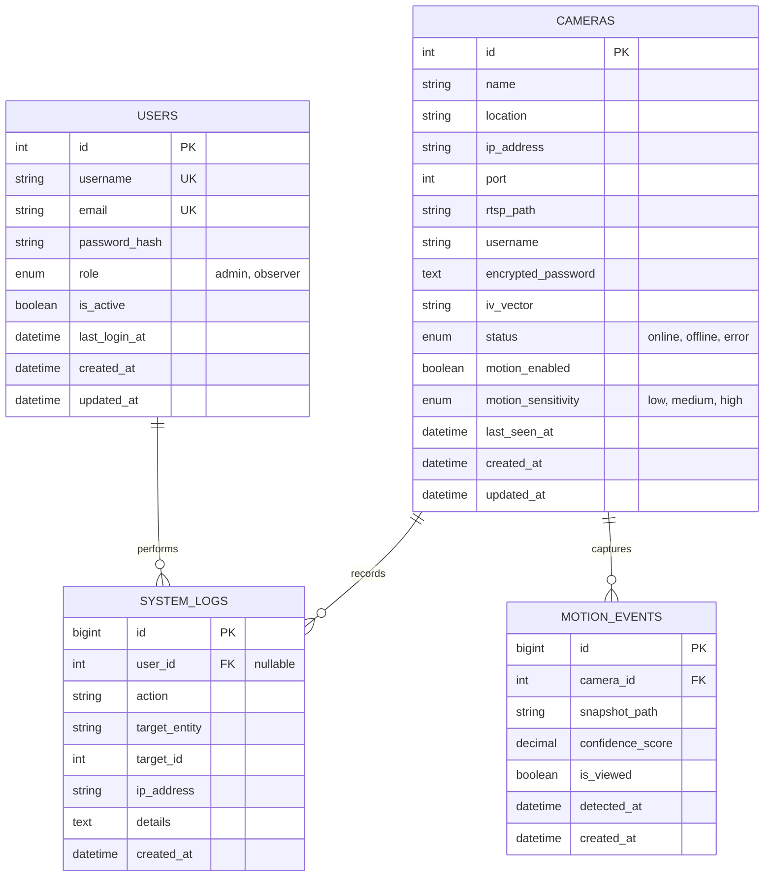

# Database Architecture & Specification

## Database Engine
- **Engine:** MySQL 8.0+ / MariaDB 10.4+ (XAMPP & Docker compatible)
- **Database Name:** `rstp_cctv_db`
- **Character Set:** `utf8mb4`
- **Collation:** `utf8mb4_unicode_ci`
- **Storage Engine:** `InnoDB`

---

## 1. Entity-Relationship Diagram (ERD)



---

## 2. Data Dictionary

### 2.1. Table: `users`
Menyimpan data otentikasi dan hak akses akun sistem.

| Field | Type | Null | Default | Description |
| :--- | :--- | :--- | :--- | :--- |
| `id` | INT AUTO_INCREMENT | NO | PK | ID unik pengguna |
| `username` | VARCHAR(50) | NO | UNIQUE | Username login unik |
| `email` | VARCHAR(100) | NO | UNIQUE | Alamat email pengguna |
| `password_hash` | VARCHAR(255) | NO | | Password hash (Bcrypt / Argon2id) |
| `role` | ENUM('admin', 'observer') | NO | 'observer' | Level akses sistem |
| `is_active` | TINYINT(1) | NO | 1 | 1 = Aktif, 0 = Nonaktif/Banned |
| `last_login_at` | DATETIME | YES | NULL | Waktu login terakhir |
| `created_at` | DATETIME | NO | CURRENT_TIMESTAMP | Waktu pembuatan akun |
| `updated_at` | DATETIME | NO | CURRENT_TIMESTAMP ON UPDATE | Waktu perubahan terakhir |

### 2.2. Table: `cameras`
Menyimpan konfigurasi parameter koneksi CCTV / IP Camera.

| Field | Type | Null | Default | Description |
| :--- | :--- | :--- | :--- | :--- |
| `id` | INT AUTO_INCREMENT | NO | PK | ID unik kamera |
| `name` | VARCHAR(100) | NO | | Nama kamera (misal: "Simpang Lima Barat") |
| `location` | VARCHAR(255) | YES | NULL | Deskripsi lokasi / koordinat GPS |
| `ip_address` | VARCHAR(45) | NO | | IPv4 atau IPv6 kamera |
| `port` | INT | NO | 554 | Port RTSP (default 554) |
| `rtsp_path` | VARCHAR(255) | NO | '/live/ch0' | Path stream RTSP |
| `username` | VARCHAR(100) | YES | NULL | Username autentikasi kamera |
| `encrypted_password` | TEXT | YES | NULL | Password terenkripsi AES-256-CBC |
| `iv_vector` | VARCHAR(64) | YES | NULL | Initialization vector untuk dekripsi |
| `status` | ENUM('online','offline','error')| NO | 'offline' | Status konektivitas saat ini |
| `motion_enabled` | TINYINT(1) | NO | 1 | 1 = Deteksi aktif, 0 = Nonaktif |
| `motion_sensitivity` | ENUM('low','medium','high') | NO | 'medium' | Sensitivitas threshold deteksi |
| `last_seen_at` | DATETIME | YES | NULL | Waktu terakhir stream berhasil di-ping |
| `created_at` | DATETIME | NO | CURRENT_TIMESTAMP | Waktu penambahan |
| `updated_at` | DATETIME | NO | CURRENT_TIMESTAMP ON UPDATE | Waktu update |

### 2.3. Table: `motion_events`
Menyimpan log kejadian saat motion detector mendeteksi perubahan visual.

| Field | Type | Null | Default | Description |
| :--- | :--- | :--- | :--- | :--- |
| `id` | BIGINT AUTO_INCREMENT | NO | PK | ID unik event |
| `camera_id` | INT | NO | FK | Terhubung ke `cameras.id` (ON DELETE CASCADE) |
| `snapshot_path` | VARCHAR(255) | NO | | Path relatif file gambar snapshot di storage |
| `confidence_score`| DECIMAL(5,2) | NO | 0.00 | Skor perubahan pixel (0 - 100%) |
| `is_viewed` | TINYINT(1) | NO | 0 | 0 = Belum diperiksa, 1 = Sudah diperiksa |
| `detected_at` | DATETIME | NO | | Waktu saat gerakan terdeteksi |
| `created_at` | DATETIME | NO | CURRENT_TIMESTAMP | Waktu pencatatan record |

### 2.4. Table: `system_logs`
Menyimpan riwayat audit trail aktivitas pengguna (terutama aksi admin).

| Field | Type | Null | Default | Description |
| :--- | :--- | :--- | :--- | :--- |
| `id` | BIGINT AUTO_INCREMENT | NO | PK | ID log |
| `user_id` | INT | YES | NULL | FK ke `users.id` (ON DELETE SET NULL) |
| `action` | VARCHAR(50) | NO | | Jenis aksi: LOGIN, ADD_CCTV, EDIT_CCTV, DELETE_CCTV |
| `target_entity` | VARCHAR(50) | YES | NULL | Entitas target (misal: 'cameras') |
| `target_id` | INT | YES | NULL | ID entitas yang diproses |
| `ip_address` | VARCHAR(45) | YES | NULL | IP address pengguna |
| `details` | TEXT | YES | NULL | Informasi detail perubahan dalam format JSON |
| `created_at` | DATETIME | NO | CURRENT_TIMESTAMP | Waktu eksekusi aksi |

---

## 3. Production Ready SQL DDL Script

Script ini dapat langsung dieksekusi di **phpMyAdmin** atau terminal MySQL:

```sql
-- Buat database jika belum ada
CREATE DATABASE IF NOT EXISTS `rstp_cctv_db` 
CHARACTER SET utf8mb4 
COLLATE utf8mb4_unicode_ci;

USE `rstp_cctv_db`;

-- 1. Tabel Users
CREATE TABLE IF NOT EXISTS `users` (
    `id` INT AUTO_INCREMENT PRIMARY KEY,
    `username` VARCHAR(50) NOT NULL UNIQUE,
    `email` VARCHAR(100) NOT NULL UNIQUE,
    `password_hash` VARCHAR(255) NOT NULL,
    `role` ENUM('admin', 'observer') NOT NULL DEFAULT 'observer',
    `is_active` TINYINT(1) NOT NULL DEFAULT 1,
    `last_login_at` DATETIME NULL,
    `created_at` DATETIME NOT NULL DEFAULT CURRENT_TIMESTAMP,
    `updated_at` DATETIME NOT NULL DEFAULT CURRENT_TIMESTAMP ON UPDATE CURRENT_TIMESTAMP,
    INDEX `idx_users_role` (`role`),
    INDEX `idx_users_status` (`is_active`)
) ENGINE=InnoDB DEFAULT CHARSET=utf8mb4 COLLATE=utf8mb4_unicode_ci;

-- 2. Tabel Cameras
CREATE TABLE IF NOT EXISTS `cameras` (
    `id` INT AUTO_INCREMENT PRIMARY KEY,
    `name` VARCHAR(100) NOT NULL,
    `location` VARCHAR(255) NULL,
    `ip_address` VARCHAR(45) NOT NULL,
    `port` INT NOT NULL DEFAULT 554,
    `rtsp_path` VARCHAR(255) NOT NULL DEFAULT '/live/ch0',
    `username` VARCHAR(100) NULL,
    `encrypted_password` TEXT NULL,
    `iv_vector` VARCHAR(64) NULL,
    `status` ENUM('online', 'offline', 'error') NOT NULL DEFAULT 'offline',
    `motion_enabled` TINYINT(1) NOT NULL DEFAULT 1,
    `motion_sensitivity` ENUM('low', 'medium', 'high') NOT NULL DEFAULT 'medium',
    `last_seen_at` DATETIME NULL,
    `created_at` DATETIME NOT NULL DEFAULT CURRENT_TIMESTAMP,
    `updated_at` DATETIME NOT NULL DEFAULT CURRENT_TIMESTAMP ON UPDATE CURRENT_TIMESTAMP,
    INDEX `idx_cameras_status` (`status`),
    INDEX `idx_cameras_motion` (`motion_enabled`)
) ENGINE=InnoDB DEFAULT CHARSET=utf8mb4 COLLATE=utf8mb4_unicode_ci;

-- 3. Tabel Motion Events
CREATE TABLE IF NOT EXISTS `motion_events` (
    `id` BIGINT AUTO_INCREMENT PRIMARY KEY,
    `camera_id` INT NOT NULL,
    `snapshot_path` VARCHAR(255) NOT NULL,
    `confidence_score` DECIMAL(5,2) NOT NULL DEFAULT 0.00,
    `is_viewed` TINYINT(1) NOT NULL DEFAULT 0,
    `detected_at` DATETIME NOT NULL,
    `created_at` DATETIME NOT NULL DEFAULT CURRENT_TIMESTAMP,
    CONSTRAINT `fk_motion_camera` FOREIGN KEY (`camera_id`) REFERENCES `cameras` (`id`) ON DELETE CASCADE,
    INDEX `idx_motion_detected_at` (`detected_at`),
    INDEX `idx_motion_is_viewed` (`is_viewed`),
    INDEX `idx_motion_camera_time` (`camera_id`, `detected_at`)
) ENGINE=InnoDB DEFAULT CHARSET=utf8mb4 COLLATE=utf8mb4_unicode_ci;

-- 4. Tabel System Logs
CREATE TABLE IF NOT EXISTS `system_logs` (
    `id` BIGINT AUTO_INCREMENT PRIMARY KEY,
    `user_id` INT NULL,
    `action` VARCHAR(50) NOT NULL,
    `target_entity` VARCHAR(50) NULL,
    `target_id` INT NULL,
    `ip_address` VARCHAR(45) NULL,
    `details` TEXT NULL,
    `created_at` DATETIME NOT NULL DEFAULT CURRENT_TIMESTAMP,
    CONSTRAINT `fk_logs_user` FOREIGN KEY (`user_id`) REFERENCES `users` (`id`) ON DELETE SET NULL,
    INDEX `idx_logs_action` (`action`),
    INDEX `idx_logs_created_at` (`created_at`)
) ENGINE=InnoDB DEFAULT CHARSET=utf8mb4 COLLATE=utf8mb4_unicode_ci;
```

---

## 4. Default Seed Data (Initial Users)

Password default untuk seed:
- Akun Administrator: `admin123`
- Akun Observer: `observer123`
*(Di-hash menggunakan PHP `password_hash('password', PASSWORD_BCRYPT)`)*:

```sql
INSERT INTO `users` (`username`, `email`, `password_hash`, `role`, `is_active`) VALUES
('admin', 'admin@cctv.local', '$2y$10$wS6yvK1Y9fGvI85U4N3m3eK8B7fF0Fm.R1rWzN.QjKkS4p0m5M6v.', 'admin', 1),
('observer', 'observer@cctv.local', '$2y$10$T8VqgN4pU6bW1hD9K2m0u.gP8fM6zX3lW2jE7sC0bF5tO8m3Q4p5e', 'observer', 1);

-- Contoh Data Kamera CCTV Jalan Raya
INSERT INTO `cameras` (`name`, `location`, `ip_address`, `port`, `rtsp_path`, `username`, `status`, `motion_enabled`) VALUES
('CCTV 01 - Simpang Sudirman', 'Jl. Jend. Sudirman KM 2', '192.168.1.101', 554, '/live/ch0', 'admin', 'online', 1),
('CCTV 02 - Flyover Thamrin', 'Flyover MH Thamrin Arah Utara', '192.168.1.102', 554, '/live/ch0', 'admin', 'online', 1),
('CCTV 03 - Bundaran HI Timur', 'Pos Bundaran HI Sisi Timur', '192.168.1.103', 554, '/live/ch0', 'admin', 'offline', 1),
('CCTV 04 - Simpang Kuningan', 'Jl. HR Rasuna Said', '192.168.1.104', 554, '/live/ch0', 'admin', 'online', 0);
```

